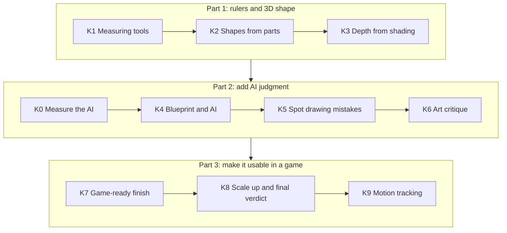
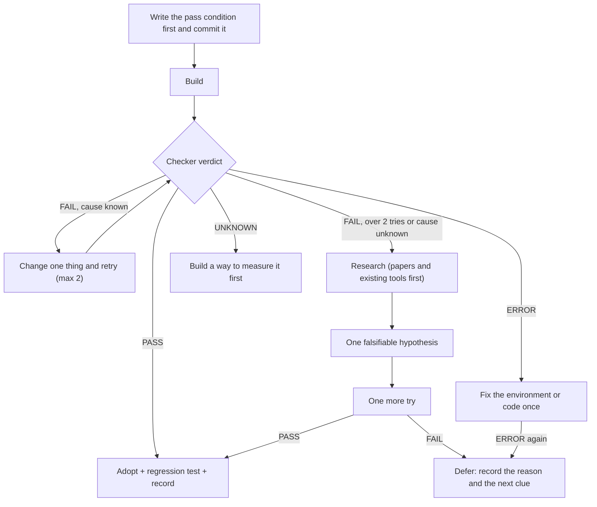

# Plastor Roadmap

[Korean version (한국어판): ROADMAP.md](ROADMAP.md) · Both versions describe the same plan with the same numbers.

**In one sentence: we want an AI to turn hand-drawn creature model sheets (front, side, back) into game-ready 3D models, the way a skilled modeler would. It already wins on synthetic tests; right now we are fixing the one thing that still fails on a real drawing: the head comes out flat.**

This document is written so that **anyone, including a junior developer, can see why we work in this order and how we decide that something worked.**
Hard technical words are used only when we really need them, and each one comes with a **plain explanation** box. Click any line marked ▶ to unfold the details.

Last updated: 2026-10-30 · Source plans (Korean): [`docs/구현계획_통합.md`](docs/구현계획_통합.md), [`docs/루프_작업목록.md`](docs/루프_작업목록.md)

> [!IMPORTANT]
> **We do not promise dates.** A stage starts when the stage before it gives a PASS, and it ends only when its own check gives a PASS. If a check fails, we find out why before moving on. We never lower the bar to make a failure pass.

---

## Contents

1. [At a glance](#1-at-a-glance)
2. [Why: the problem we are solving](#2-why-the-problem-we-are-solving)
3. [How: four rules everything follows](#3-how-four-rules-everything-follows)
4. [Where we are now](#4-where-we-are-now)
5. [Milestones: five big goals](#5-milestones-five-big-goals)
6. [Stages K0–K9](#6-stages-k0k9)
7. [Near-term work: now, next, later](#7-near-term-work-now-next-later)
8. [How a verdict is made](#8-how-a-verdict-is-made)
9. [Risks and what we do about them](#9-risks-and-what-we-do-about-them)
10. [What we decided not to do](#10-what-we-decided-not-to-do)
11. [How to help](#11-how-to-help)
12. [Appendix: glossary, old stage names, document map](#12-appendix)

---

## 1. At a glance

| Area | Status | In one line |
|---|---|---|
| Harness layer (MCP server, traceability, loop engine) | ✅ **Mostly done** | Self-tests 12/12, 11/11, 17/17 PASS. Moving the work list into the loop engine is the last piece |
| 3D from **synthetic** creatures | ✅ **PASS** (synthetic scope) | Volume IoU 0.92 vs 0.59 for the old method |
| 3D from a **real hand drawing** | ❌ **FAIL** (current blocker) | The head comes out flat, like a thin board |
| Measuring what the AI can judge (K0) | 🟡 **In progress** | One AI family's results are in; final verdict pending |
| Game-ready finish (retopology, UV, texture, rigging, Godot) | ⬜ **Waiting** | Starts after a real drawing passes |

> [!TIP]
> **In plain words:** first we build a **ruler** that tells us whether a result is good (K1). Then we build shapes and measure them with that ruler (K2–K3). Then we add the AI's judgment (K4–K6). Finally we make the result usable in a game (K7–K8). Without the ruler we could never say "it got better", so the order matters.

---

## 2. Why: the problem we are solving

**AI models such as ChatGPT and Claude are good with words, but weak at four things 3D modeling needs.**

| The AI is weak at… | What goes wrong |
|---|---|
| Combining several views into one 3D shape | The front and side drawings don't "click" into one object in its head |
| Exact numbers and positions | It writes coordinates that look reasonable but are off |
| Checking its own work | It says "done, looks good" when it is not |
| Long tasks | It forgets the goal, repeats itself, or declares success too early |

Meanwhile, making 3D models by hand takes expensive tools, a big graphics card, or years of practice.
This project tries to solve the problem with **free tools on an old computer**: a GTX 750 Ti (2 GB), an i5-3470 CPU and 16 GB of RAM.

<b>▶ "Why not just make the AI smarter?"</b>

We do not train or fine-tune the AI. That needs money and big hardware.
Instead we **surround the AI with tools that measure and rules it cannot skip.** That combination is called a **harness**.

> 💡 **In plain words:** a harness is the gear you put on a horse. It does not change how strong the horse is; it makes sure that strength goes in the right direction. Here the horse is the AI, and the gear is rules like "tools do the measuring" and "only a checker can say PASS".

Outside research points the same way. In CAD (mechanical design), feeding measurements back to the AI so it could correct itself cut the error (chamfer distance) from 28.37 to 0.74 (CADSmith; sources in [`docs/진단_방향재검토.md`](docs/진단_방향재검토.md), section 1.1).

<b>▶ First user and final result</b>

- **First user:** creature units of a separate game project. We have no right to publish its artwork, so it is not in this repository.
- **Final result:** from a drawing to a **game asset that a person can still edit and that can be animated with a skeleton.**
  The order is 3D shape → retopology (clean faces) → UV (unfolding) → texture (painting) → rigging (bones) → loading in the Godot engine.
- Every step is **judged by a checker**, never by a person's glance or the AI's own words.

---

## 3. How: four rules everything follows

These four rules are what make this a harness. Every contributor, human or AI, follows them too.

### Rule 1. The AI decides, the tools measure

The AI only chooses **names and kinds**: "this is the head, this horn is a bent tube, this ear is a flat plate".
**Every number** (position, size, angle) is measured from the drawing by a program. The tools have no input for coordinates at all; if you send one, it is rejected.

<b>▶ Why go this far?</b>

In early tests we let the AI draw coordinates directly, and triangles appeared in the wrong places. Outside studies report the same for AI-written CAD code: the syntax is right, but a part's position or one value is wrong.
So we split the work by strength: the AI is good at naming and structure, the tools are good at exact numbers.

### Rule 2. Only a check that actually ran can say PASS

There are only four verdicts: **PASS, FAIL, UNKNOWN, ERROR**.
"It looks fine" is not a verdict. **The pass condition is written before the attempt**, and it is never lowered after a failure.

<b>▶ Real mistakes this rule caught</b>

- A merge step was quietly deleting the main body (48,093 vertices → 1,912). On the surface it still passed "one piece, closed" checks.
- Running the same input twice gave different results: the code was secretly reading a file left over from the previous run.
- A number used in a diagnosis was itself wrong (overlapping shapes were counted twice). Measuring a second way caught it.

All of these were caught because we wrote the condition first, actually ran the check, and compared fingerprints. Details: [`docs/수정_기록.md`](docs/수정_기록.md), entries 44–52.

> 💡 **Fingerprint:** a short code that summarizes a result file. The same input must give the same fingerprint. If it changes, something hidden is affecting the result.

Strict rules feel slow on one task. Over many tasks they are faster, because we stop building on top of mistakes.

### Rule 3. Research must reach the code

Every idea we take from a paper or a tool gets an ID (for example `R-013`) and a decision: **adopted, deferred, rejected or pending**.
An adopted idea counts as "reflected" **only when its linked test actually ran and passed** on the current files.

<b>▶ Why we needed this</b>

We had done a lot of research, but some of it (reading depth from shading, using anatomy tools) silently dropped out of the plan. We only noticed when the project owner pointed it out.
So we built a registry (`trace/registry.json`) and a checker (`mh trace_check`) so that **a program finds forgotten or unlinked research**. The registry has 104 entries today (43 adopted, 38 pending, 15 rejected, 8 deferred).

> 💡 **In plain words:** like writing meeting decisions in a notebook and ticking them off when they are really done, except a program does the ticking. One trap it catches: someone writing the idea's ID into the code without building the feature.

### Rule 4. Loop rules live in a program, not in the AI's memory

"Write the condition → build → judge → on failure find the cause and retry → after two failed retries, research → one hypothesis → one more try → otherwise defer". A **state machine written in Rust** enforces this flow.
The AI does only the one action the engine hands it and reports back. **If the AI says "it passed", the engine ignores that and runs the check itself.**

<b>▶ What is a state machine?</b>

> 💡 **In plain words:** like a traffic light. Rules such as "green comes after red" are built into the machine, so the order holds even if a driver forgets. Here the built-in rules are things like "after two failures, go to research" and "refuse a changed pass condition unless a reason is written".

---

## 4. Where we are now

**We clearly win on synthetic creatures, but we still lose on one real hand drawing.** Every number below comes from a check that actually ran.

### 4.1 Synthetic tests: PASS

Our own program generates fake creatures (head, neck, body, legs, tail, horns, ears) and keeps the true 3D shape as an answer key. Half of them have deliberate drawing mistakes mixed in. We score on 12 held-out creatures the method never saw while it was being tuned.

| Measure | New method (primitive fitting, `mh fit`) | Old method (two-view hull) | What it means |
|---|---|---|---|
| Volume IoU (higher is better) | **0.92** | 0.59 | How much the solid overlaps the true shape |
| 3/4-view width-ratio error (lower is better) | **0.02** | 0.16 | Whether it looks boxy from a 45° angle |
| Roughness (lower is better) | **2.0°** | 6.7° | Whether the surface has stair steps |

<b>▶ Why you should not trust these numbers too much</b>

The synthetic creatures are built from ellipsoids and tubes, and our new method also builds from ellipsoids and tubes. **Comparing like with like flatters us.**
We wrote this risk down before running, and that is why we test a real hand drawing separately. That result is section 4.2.

<b>▶ What does "volume IoU 0.92" mean?</b>

**IoU** means "Intersection over Union". Put our 3D model and the true model in the same place. Then:

- *Intersection* = the space both of them fill.
- *Union* = the space either one fills.
- IoU = intersection ÷ union. **1.0 is a perfect match; 0 means no overlap at all.**

0.92 means almost the same shape. 0.59 means only roughly right.

### 4.2 Real hand drawing (bison head): FAIL

- **The head comes out like a flat disc.** Front and side silhouettes alone do not tell how thick something is front to back.
- Anatomy rules (mirror pairs, number of ears) fixed the fake ears and the uneven horns. The head is still thin (shortest axis / longest axis = 0.355).
- A small depth-guessing AI (Depth Anything V2 Small, runs on the CPU) raised the side silhouette from 0.850 to 0.895, but **the head is still flat.**

<b>▶ Why can't a silhouette tell depth?</b>

> 💡 **In plain words:** shine a flashlight at a wall. A ball and a flat plate cast the same round shadow from the front. Lighting from the side still leaves a direction you can't see. So besides the shadow (silhouette), we need **information inside the drawing** (shading, section lines) or **common sense about how heads are built**.

Three leads for what to try next:
1. **Read the shading bands (K3):** work backwards from the light/dark edges of a cel-shaded drawing to the direction the surface faces.
2. **Use fewer blobs for the head:** splitting the head into many ellipsoids lets a thin plate hide where the silhouette says nothing.
3. **AI structure judgment (K4):** decide the big structure first, such as "a ball over the skull plus a muzzle block".

### 4.3 Harness layer: mostly done

| Part | Status | Evidence |
|---|---|---|
| MCP server `mh mcp` (14 tools the AI uses) | PASS | `tests/selftest_mcp.py` 12/12 |
| Traceability checker `mh trace_check` | PASS per slot, overall FAIL | Self-test 11/11 PASS. 29 older research entries are not yet linked to code and tests |
| Branching loop engine `mh loop_next` | Nearly done | Self-test 17/17 PASS. Only moving the work list into the engine's plan file is left |

> [!NOTE]
> **The traceability checker's overall FAIL is expected.** It means "there is unfinished work", and its problem list *is* the to-do list. We do not hide it.

---

## 5. Milestones: five big goals

Instead of dates, each milestone says **what must be true for it to be done.** We do this so we never have to make up a schedule (this project does not publish numbers it has not checked).

| # | Milestone | Done when | Status |
|---|---|---|---|
| ① | Win on synthetic data | On 12 held-out tasks, volume IoU ≥ old method + 0.15, and more (unfold below) | ✅ **PASS** |
| ② | Pass one real hand drawing | Bison head: one connected body, no flat plate, 2 ears, limited silhouette drop | ❌ **FAIL, in progress** |
| ③ | The AI makes it better | The AI writing a blueprint through MCP beats fitting with no AI | ⬜ **Waiting** |
| ④ | Usable in a game | Quads ≥ 95%, at most 4 bone influences, loads in Godot | ⬜ **Waiting** |
| ⑤ | Final verdict | No score loss vs. the current harness + three or more art measures improve + most people prefer it | ⬜ **Waiting** |

<b>▶ ① Win on synthetic data: every condition written before running</b>

Average over 12 held-out tasks, against the true 3D shape.
- Volume IoU ≥ old method + 0.15 → 0.916 vs 0.595 (PASS)
- Silhouette (front and side average) ≥ old method − 0.01 → 0.966 vs 0.949 (PASS)
- |3/4 width ratio − truth| ≤ half the old method's error → 0.022 vs 0.155 (PASS)
- Roughness ≤ old method → PASS
- Tasks with one connected body ≥ 11/12 → PASS

Adding smooth joining (smooth-min) later improved roughness further, from 2.71° to 2.00°.

<b>▶ ② Pass one real hand drawing: conditions and current values</b>

Real bison head drawing, conditions written before running (work item 4b, part (b)).

| Condition | Current value | Verdict |
|---|---|---|
| Body count 1 | 3 (latest attempt) | FAIL |
| No flat disc (short axis / long axis ≥ 0.35) | 0.355, but the head splits into "a thin plate + a long block" | FAIL (visual check) |
| No fake ears (2 ears) | 2 | PASS |
| Silhouette ≥ previous best (attempt 16) − 0.03 | Front 0.894 / side 0.895, latest with the depth term (attempt 16: 0.977 / 0.926) | FAIL |

The depth-estimation attempt (work item 4d) has its own stricter condition (head minimum axis ratio ≥ 0.5, silhouette drop ≤ 0.01). It also still FAILs.

<b>▶ ③–⑤ in detail</b>

- **③ The AI makes it better:** on the same tasks (synthetic held-out set + bison), "Claude Code writing and fixing a blueprint through MCP" vs. "automatic fitting with no AI". The AI version must win on the bison before we can call this an "AI modeling harness". The numeric condition **will be written before running** (not written yet). See [issue #7](https://github.com/endlessGold/Plastor/issues/7).
- **④ Usable in a game (K7 and work item 8):** editable Blender objects match the fitted result with volume IoU ≥ 0.97; after retopology, quads ≥ 0.95 and silhouette drop ≤ 0.01; texture color error per material ΔE < 10; at most 4 bone influences per vertex; glTF export loads in Godot; the rig-readiness check keeps passing.
- **⑤ Final verdict (K8):** on 10+ tasks, no loss in reprojection IoU vs. the current harness, three or more art measures improve (two AI families agree), and most people in a side-by-side comparison say "the new one is better".

---

## 6. Stages K0–K9

All stages use one naming scheme, `K0`–`K9` (old names like M, S, R, P are mapped in the [appendix](#12-appendix)).
**Each stage's pass condition is written into the plan and committed before running.** We tune on development tasks and judge only on held-out tasks.

> [!TIP]
> **Why split development and held-out tasks?** If you study the exam questions in advance, you get a high score but learn nothing about your real skill. So we keep one set of problems for fixing things (development) and another set only for grading (held-out). Without this split you get an illusion called **overfitting**.

<b>▶ K0. Measure what the AI can judge 🟡 in progress</b>

**Goal:** find out, with numbers, which decisions the AI gets right enough to be trusted with, and which must stay with the tools.

**Why:** "the AI recognizes parts well" was an assumption. Trusting it without measuring would break Rule 2.

**What we do:** quizzes with known answers, made from synthetic creatures. Two AI families (Claude Sonnet and Codex) answer in swapped order. The answers are combined with the `judge` tool.

**Pass conditions (written before running):**
1. Part recognition (present or not, how many): accuracy ≥ 0.9 and confirmed rate ≥ 0.8 → the AI may decide this.
2. Choosing shape types (blob, tube, plate): accuracy ≥ 0.9 → the AI chooses in K4.
3. Seeing small parts: a zoomed image (`zoom`) beats the full image by +0.2 or more at half size.
4. Art judgment (good vs. deliberately broken): accuracy ≥ 0.8, two-family kappa ≥ 0.6.
5. Stability: repeat agreement ≥ 0.9, order flips ≤ 0.1.

**Status:** interim Sonnet results on 62 answers: set 1 = 1.0, set 2 = 0.958, set 4 = 1.0, stability = 1.0. In set 3, even at half size the full image already showed the ears, so zoom gave no gain (condition 3 FAIL). Codex is being re-run after an execution bug fix, so **the final verdict is still UNKNOWN**.

**How to help:** [issue #7](https://github.com/endlessGold/Plastor/issues/7).

> 💡 **Kappa (agreement beyond luck):** two judges picking at random between two answers still agree about half the time. Cohen's kappa removes the luck part: 1.0 = perfect agreement, 0 = no better than luck, 0.6 or more is usually called "substantial".

> ⚠️ Two AIs giving the same answer does not make it right. Research shows that **stronger models tend to make the same mistakes**. So we mix in calibration questions with known answers and measure how often both families are **wrong together**.

<b>▶ K1. Measuring tools ✅ mostly PASS</b>

**Goal:** build the rulers that every later stage uses. We already know that silhouettes alone can fool us.

**New rulers:**
- **3/4-view width ratio:** width seen from 45°. An ellipsoid is about 0.71; a box is close to 1. It catches boxy heads.
- **Roughness:** measures small stair steps on the surface. It separates a smooth sphere (0.48°) from a stepped one (20.09°) (version 2).
- **Landmark error:** how far named points (nose tip, horn tip) are from the truth.
- **Normal and wireframe images:** shaded images hide broken faces, so we also look at face directions and edges directly.

**Status:** 5 self-tests PASS. The first roughness formula (v1) could not catch stair steps and FAILED; we recorded that, with its numbers, and switched to v2.
**Remaining:** a third real head drawing, a task with a part visible in only one view, reporting cross-section fill ratio.

Why is a matching outline not enough?

You can match the front and side outlines perfectly and still have the wrong shape. A published study (SAUCD) found a badly distorted mesh that scored 0.96 on outline IoU while people rated it only 2.74 out of 5. That is why we also score volume, smoothness, the 3/4 view and landmarks.

<b>▶ K2. Shapes from simple parts (SDF primitives) ✅ synthetic, ❌ real</b>

**Goal:** pick a basic shape (primitive) for each part, fit its size and shape to the drawing, and join everything into one piece.

**Three primitives (operators):**
- **Blob:** head, body. Several stretched balls (ellipsoids).
- **Tube:** horns, legs, tail, neck. A bent pipe whose thickness changes.
- **Plate:** ears, fins. A flat piece with some thickness.

**Fitting rules:** match only the pixels that are visible in the drawing; pixels covered by another part count as "don't care". Hand-drawn views never line up exactly, so small mismatches between views are allowed. A part visible in only one view gets a default thickness instead of an invented width.

**Joining:** SDF union with smooth blending (smooth-min). The result is always one piece, so a merge can never accidentally delete the body.

**Per-part conditions (written before running):**
- K2a horns: silhouette ≥ 0.95, volume IoU ≥ 0.80, roughness ≤ 5°, one piece
- K2b ears: volume IoU ≥ 0.75, silhouette ≥ 0.95
- K2c joining: body count 1, joined silhouette drop ≤ 0.01
- K2d head: volume IoU is only measured (judged in K3 by comparing shading on/off)

**Status:** the whole synthetic set PASSES (section 4.1). There is no separate recorded verdict for K2a–K2d yet, so those are **UNKNOWN**. The real bison FAILS (section 4.2).

> 💡 **SDF (signed distance field):** a map that stores, for every point in space, "how far is the nearest surface, and am I inside or outside?" Joining two shapes just means taking the smaller value of the two maps, so it is far more robust than joining meshes with booleans, which often leave holes. **Smooth-min** blends that seam softly, so a leg flows into the body like on a real animal (Inigo Quilez's technique; the game *Dreams* builds whole worlds this way).

The old method: visual hull

A visual hull is what you get by cutting out the front outline and the side outline and keeping only the space inside both, like carving a block of foam with two cookie cutters. It always matches the outlines, but every horizontal slice comes out as a **rectangle**, so round things turn boxy and hidden areas come out wrong. We now use it only as a **starting shape** for fitting.

<b>▶ K3. Depth from shading (cross-contours and tone) 🔴 waiting, most important now</b>

**Goal:** read the front-to-back thickness that the silhouette does not give, from the shading bands and section lines inside the drawing. This aims straight at the flat bison head.

**What we do:**
1. Split the drawing into 3 tones per material (light, mid, dark).
2. Estimate where the light comes from (target on synthetic data: error ≤ 10°).
3. Add a "do the shading bands match?" term to the fitting score.
4. Use a cross-section template that fits the part name (ball, tube, plate, band, angular), but trust evidence in this order: section lines > shading > name template.

**Pass condition (written before running):** held-out head volume IoU ≥ 0.80 **and** shading term on − off ≥ +0.03. For horn cross-sections: "on" gives higher volume than "off", with silhouette drop ≤ 0.005.

**How to help:** [issue #2](https://github.com/endlessGold/Plastor/issues/2). This is the most important open problem.

> 💡 **Cross-contour, tone bands, cel shading:** cross-contour lines wrap around a form, like the stripes on a watermelon or lines of latitude on a globe; how they bend shows which way the surface curves. **Cel shading** draws shadows as a few flat color steps, and the edges between steps are **tone bands**; where a band edge sits tells you which way the surface faces the light. Both are clues to the surface direction (the **normal**). Research we build on: *CrossShade* (SIGGRAPH 2012) and *Inverse Toon Shading*.

> ⚠️ Real hand-drawn shading is not as regular as synthetic shading. So even after a synthetic PASS, we check the bison drawing separately.

<b>▶ K4. Blueprint and AI ⬜ waiting</b>

**Goal:** the AI writes a **blueprint (JSON)** with the part list, primitive types, attachment points, mirror pairs, cross-section templates, reasons and confidence. The tools build exactly what it says.

**What we build:**
- The blueprint format: [English guide](docs/en/blueprint-format.md) (Korean source: [`docs/설계도_형식.md`](docs/설계도_형식.md)). Anatomy (bone landmarks, proportions) and perspective hints live inside it too.
- A check before building: do the cross-sections match the drawing's widths, are mirror pairs symmetric, is each attachment point on the parent's surface?
- Part-level commands, all without coordinates: `rebuild(part)`, `section_set`, `scale_rel`, `attach`, `mirror`. **Changing one part must leave every other part's fingerprint unchanged.**
- Procedure cards: a skilled modeler's working order as cards (for example, "blocking out a creature head"), with sources and one human review.

**Pass conditions:** rebuilding the 6 synthetic tasks from blueprints alone scores the same as or better than K2–K3; the change-one-part test PASSES; real drawings get a visual check.

**How to help:** [issue #7](https://github.com/endlessGold/Plastor/issues/7).

> 💡 **In plain words:** the architect (AI) draws "three rooms, living room facing south", and the builder (tools) measures and builds it. The architect never places individual bricks.

<b>▶ K5. Spot drawing mistakes (shape judgment, intent) ⬜ waiting</b>

**Goal:** sort every drawing element into five kinds: **identity** (what defines the creature), **intended exaggeration** (style), **uncertain**, **error** (drawn wrong) and **conflict** (views disagree). Real errors are not copied.

**Why:** right now every pixel has the same weight. So when the drawing is wrong, **copying the mistake exactly becomes the "best" answer**.

**Measuring fairly:** use "error-injection tasks", where the true answer is 3D and only the drawing has mistakes (view height mismatch, an offset mirror part, a missing ear, size differences, a stretched jaw, and so on). The original tracing is always kept and fixes are stored as a layer on top, so every fix can be undone.

**Pass conditions (written before running, [`docs/설계_형태판단.md`](docs/설계_형태판단.md) 6.3):** precision ≥ 0.9, wrongly "fixing" intended oddities ≤ 0.05, recall ≥ 0.6, confirmed rate ≥ 0.7, confirmed-decision accuracy ≥ 0.95.

> 💡 **Precision and recall:** of the things marked "error", the share that really are errors is precision; of the real errors, the share we found is recall. Precision gets the higher bar, because "fixing" a perfectly good style choice is worse than missing an error.

<b>▶ K6. Art critique ⬜ waiting</b>

**Goal:** catch "passes every check but looks bad". We have already produced a box-shaped head that passed every closed-and-one-piece check.

**What we do:** measure with numbers first (proportions, curvature distribution, whether the silhouette reads at 64 px, consistent face directions). Only what numbers cannot measure goes to two AI families, asked twice in swapped order. At most 3 rounds per stage, one problem fixed at a time. Breaking anatomy rules only gives a **warning** (for a stylized design, the drawing wins).

**Pass conditions:** item scores separate good models from deliberately broken ones (proportion, silhouette, shape language) with two-family agreement ≥ 0.8, and score the boxy bison head (attempt 16) low on "shape language".

<b>▶ K7. Game-ready finish ⬜ waiting</b>

**Goal:** a model a person can edit and a game can animate.

**Steps and conditions:**
1. **Export in editable form:** tubes → Blender curve + bevel, blobs → subdivision surface, with sliders, then re-fit after edits. Condition: volume IoU ≥ 0.97 vs. the fitted result. [Issue #4](https://github.com/endlessGold/Plastor/issues/4).
2. **Retopology (QuadriFlow):** quads ≥ 0.95, silhouette drop ≤ 0.01, denser loops at joints.
3. **UV unwrapping:** PartUV or Blender Smart UV.
4. **Texture:** project the drawing's colors. Average color error per material ΔE < 10.
5. **Rigging:** bones from the blueprint's bone landmarks, automatic weights, at most 4 bone influences per vertex, and an automatic bend test.
6. **Export:** glTF that loads in Godot. [Issue #5](https://github.com/endlessGold/Plastor/issues/5).

Glossary: retopology, UV, rigging, bone influences, glTF, ΔE

- **Retopology:** rebuilding the surface as a clean grid of four-sided faces (quads). Clean quads bend nicely when animated; messy triangles crease and tear. **QuadriFlow** (SGP 2018 best paper) is built into Blender.
- **UV:** unfolding the 3D surface flat, like peeling an orange, so a 2D image can be painted on it.
- **Rigging:** putting a skeleton inside the model and deciding which bones move which parts of the skin.
- **Bone influences:** how many bones pull on one point of the skin. Game engines usually allow **4**; more get cut off and cause ugly bends.
- **Bend test:** bend each joint by set angles, then measure stretching and flipped faces automatically. Riggers do this by hand; we automate it.
- **glTF:** an open standard 3D file format, sometimes called "the JPEG of 3D". Godot loads it directly.
- **ΔE (delta E):** color difference as the human eye sees it. Below about 10, colors read as the same family.

<b>▶ K8. Scale up and final verdict ⬜ waiting</b>

**Goal:** show that it works on **many creatures**, not just one bison.

- 10+ tasks, including openly licensed drawings ([issue #3](https://github.com/endlessGold/Plastor/issues/3): we need artists for this). One pack per species, so only the drawing and the part table change.
- Ledger statistics by failure type, better lesson search.
- **Final verdict (all three must hold):** no loss in reprojection IoU vs. the current harness, three or more art measures improve (two families agree), and most people in a side-by-side comparison prefer the new result.

<b>▶ K9. Motion tracking ⬜ research first</b>

**Goal:** capture an animal's motion from video and move it onto our rigged creatures. Research comes first (MoCapAnything, QuadMocap). **The pass condition is UNKNOWN until that research is done, and we will not invent one.**

---

## 7. Near-term work: now, next, later

Separately from the stages, the concrete work items live in [`docs/루프_작업목록.md`](docs/루프_작업목록.md). The numbers below are that document's item numbers.

### Now (in progress)

| Item | What | Done when |
|---|---|---|
| 5 · K0 | Finish measuring the AI | Codex answers are in and conditions 1–5 are judged |
| 4g (d) | Move the work list into the loop engine's plan file (`loop/plan.json`) | `loop_next` picks the right current item |
| 4h · 4f-① | Link 29 older research entries to code and tests | `mh trace_check` reports zero remaining problems ([issue #1](https://github.com/endlessGold/Plastor/issues/1)) |

### Next (after the above)

| Item | What | Why in this order |
|---|---|---|
| K3 · 4d | Depth from shading, fewer head blobs | The biggest blocker for milestone ② (real drawing) |
| 4h · LLM A/B | AI writing a blueprint through MCP vs. automatic fitting | Evidence for milestone ③; needs K0 results to decide what the AI does |
| 6 · K5 | Five-way drawing-element classification, ignore errors | Stop copying mistakes |

### Later

| Item | What |
|---|---|
| 8 · K7 | Editable Blender output, retopology, UV, texture, rigging, Godot |
| 7 | Move the remaining Python (tracing, build pipeline) to Rust ([issue #6](https://github.com/endlessGold/Plastor/issues/6)) |
| K6 · K8 · K9 | Art critique, scale-up and final verdict, motion tracking |

<b>▶ Deferred items and what reopens them</b>

- **4b anatomy rules on the bison, part (b):** the checker itself (a) and "no synthetic regression" (c) PASS. Only the bison head thickness (b) FAILS and is deferred. It reopens when K3 (shading) or K4 (AI structure judgment) is done.
- **4d learned models as priors:** ① monocular depth estimation reads curvature *inside* one part but not front/back order *between* parts (within-part rank correlation 0.82–0.86, whole picture 0.659). ② Next, check whether TripoSR runs on the CPU. ③ Hunyuan3D-2mini only if ① and ② are not enough.

> 💡 **Rank correlation:** how well two lists agree on "which is bigger". 1 means the same order. Here we compared the AI's guessed front-to-back order with the true order.

---

## 8. How a verdict is made

<b>▶ The four verdicts, exactly</b>

| Verdict | Meaning | Counts as a pass? |
|---|---|---|
| **PASS** | A check that actually ran says the condition was met | Yes (only this one) |
| **FAIL** | It ran and fell short | No |
| **UNKNOWN** | Nothing can measure it yet, or it was not measured | No |
| **ERROR** | The checker or the environment broke, so there is no verdict | No |

"The AI says it succeeded" is not on this list. It is not a verdict.

<b>▶ What happens after a failure (the loop engine's rules)</b>

All of this lives in code (`rust/src/loopeng.rs`, `rust/src/trace.rs`), not just in this document.

> 💡 **Falsifiable hypothesis:** a guess that comes with a result that would prove it wrong. "Shading bands will help" is not falsifiable. "With the shading term on, head volume IoU rises by at least 0.03; if it doesn't, the idea is wrong" is. We require this so that failed ideas really get dropped instead of being tweaked forever.

<b>▶ When a pass condition may change, and when it may not</b>

- **Not allowed:** lowering a condition after a failure.
- **Allowed:** adding a condition or making one stricter before running (for example, roughness ≤ 5° was added to K2a).
- **Allowed, but must be recorded:** when the test method itself was flawed. Fix it, and keep the original numbers and the reason (for example, K1 roughness v1 → v2).
- Changing the overall success conditions needs the **project owner's approval**.

---

## 9. Risks and what we do about them

| Risk | Why it matters | What we do |
|---|---|---|
| Synthetic tests flatter us | The answers and our method use the same kind of shapes, so scores can be inflated | A real drawing is judged separately; we ask for openly licensed drawings (section 11) |
| A silhouette cannot give depth | Heads come out flat (the current blocker) | K3 shading, fewer head blobs, K4 AI structure judgment |
| Two AIs can be wrong together | The rule "two families agree = correct" can break | Measure joint errors with calibration questions; drop the rule if they are high |
| Chasing one score hurts quality | Chasing silhouette 1.000 once cost us volume and smoothness | A diagnostic table, not one score (volume, 3/4 width, roughness, landmarks, human comparison) |
| Old hardware | Big 3D generation models do not run | Learned models are used only as hints for fitting, never as the output. Models that need custom CUDA kernels (such as TRELLIS) are out |
| Test drawings cannot be published | Outside contributors cannot run the real-drawing tests | Ask for openly licensed creature sheets; anyone can generate synthetic tasks |
| The harness grows without getting better | Docs, cards and skills once grew while quality stood still | Keep only what was measured to help; a cards-on vs. cards-off comparison is on the to-do list |

---

## 10. What we decided not to do

So we don't repeat mistakes, here is **what we tried and dropped** and **what we deliberately avoid**.

<b>▶ Methods we dropped (checked by experiment)</b>

| Method | Why it was dropped |
|---|---|
| Two-view hull as the main way to build the body | Silhouette 0.92–0.97 but volume only 0.39–0.63, boxy. Now used only as the **starting shape** for fitting |
| The "round hull" (sweep + silhouette fill) and porting it to Rust | Covered only 47–49% of a true horn, worse than the plain hull |
| Extending the ring cage, the second-stage handle refinement (fitloop) | No gain on the bison (front IoU 0.918 → 0.914) |
| Ellipse cross-sections inside the hull | Only +0.03 |
| Five surface-smoothing tricks | None reduced the stair steps while keeping the silhouette |
| Automatic segmentation (SAM) of small parts by a size threshold | Lower than "SAM on ears only" in all three benchmarks |
| An image AI for cel-shaded pictures (Laya Vision) | About 0.53 in our test |
| "Silhouette match = success" | A distorted mesh can still score IoU 0.96 (SAUCD study) |

The full list with reasons is in `trace/registry.json`: look for entries marked rejected (기각) or deferred (보류).

<b>▶ Things we deliberately avoid</b>

- **Paid APIs and big-GPU requirements:** anyone should be able to run it at home.
- **Training or fine-tuning AI models:** we solve it with the harness (rules and tools).
- **The AI writing coordinates or vertex values:** Rule 1.
- **Other people's art without permission:** only drawings we may redistribute.
- **Growing the Python side:** the control and tool layers are Rust. Python stays only for work inside Blender (`bpy`) and for learned-model workers.

<b>▶ How conflicting decisions across documents were settled (summary)</b>

We pulled 110 "we will do this" items out of 18 research and design documents and compared them. 20 decisions conflicted. The main ones:

- The main shape representation changed several times → settled on **Rust SDF primitives (blob, tube, plate) + silhouette and shading fitting + SDF joining**.
- Five overlapping stage numbering schemes → **one scheme, K0–K9**.
- The old success conditions (design doc section 12) targeted a different system → with the **project owner's approval**, kept as history; today's success condition is the K8 final verdict.
- Whether the 3/4-view check should be an automatic pass condition → **report the number only**; a person makes the call.
- Order: retopology → UV → texture → rigging.

All 20 are in chapter 1 of [`docs/구현계획_통합.md`](docs/구현계획_통합.md) (Korean).

---

## 11. How to help

Read [CONTRIBUTING.md](CONTRIBUTING.md) first. AI coding agents should also read [AGENTS.md](AGENTS.md).

| Where help is needed | Roadmap place | Issue | Good fit for |
|---|---|---|---|
| **Read depth from drawings** (current blocker) | K3, milestone ② | [#2](https://github.com/endlessGold/Plastor/issues/2) | Graphics and geometry developers, researchers |
| **Openly licensed test drawings** | Risks (section 9), K8 | [#3](https://github.com/endlessGold/Plastor/issues/3) | Artists, creature designers |
| **Export as editable Blender objects** | K7, item 8 | [#4](https://github.com/endlessGold/Plastor/issues/4) | Blender technical artists |
| **Game-ready finish** (retopology, bend test, 4 bone influences, Godot) | K7, milestone ④ | [#5](https://github.com/endlessGold/Plastor/issues/5) | Blender technical artists, riggers |
| **Rust port** (tracing first) | Item 7 | [#6](https://github.com/endlessGold/Plastor/issues/6) | Rust developers |
| **AI evaluation** (AI through MCP vs. automatic fitting) | K0, LLM A/B, milestone ③ | [#7](https://github.com/endlessGold/Plastor/issues/7) | People with LLM or VLM evaluation experience |
| **Traceability backlog** (good first issue) | Item 4h | [#1](https://github.com/endlessGold/Plastor/issues/1) | Anyone |
| **Drawing-element classification** | K5, item 6 | None yet (open one to claim it) | Developers, researchers |
| **English docs** | Everywhere | None yet | Bilingual contributors |

> [!IMPORTANT]
> The same rules apply to contributions. **Write the pass condition in the issue first.** A pull request includes the condition, the test output, the trace IDs touched, and anything still UNKNOWN. "It seems to work" is not a pass. MIT licensed; humans and AI contributors are both welcome.

---

## 12. Appendix

<b>▶ A. Glossary</b>

| Term | Plain explanation |
|---|---|
| **3/4 width ratio** | Width seen from 45°, compared with the front width. Round shapes are about 0.71, boxes near 1. A ruler for boxy heads |
| **Deterministic tool** | A program that always gives the same output for the same input, unlike an AI |
| **Error-injection task** | A test where the true 3D answer is kept and only the drawing gets deliberate mistakes. Fairly measures whether mistakes get copied |
| **Fingerprint** | A short code summarizing a result file. Same input, same fingerprint |
| **IoU** | Intersection ÷ union. 1 means the same shape |
| **Kappa** | Agreement between judges with luck removed |
| **Landmark** | A named point such as the nose tip or horn tip |
| **LLM** | Large language model: an AI such as ChatGPT or Claude |
| **MCP** | Model Context Protocol, a standard way for an AI app to call outside tools, like a power socket with a standard shape. We expose 14 tools through `mh mcp` |
| **Mesh** | A 3D shape made of a net of small triangles or quads |
| **Normal** | The direction a point on a surface faces. It decides how light falls on it |
| **Primitive / operator** | A basic shape (blob, tube, plate) and the command that builds it |
| **Reprojection** | Rendering our 3D model back into front and side views and comparing with the drawing |
| **Roughness** | How stair-stepped a surface is, in degrees. Lower is smoother |
| **SDF** | A map of "distance to the surface" for every point. Shapes join without breaking |
| **Silhouette** | The outline of a shape, like its shadow |
| **Smooth-min** | The math that blends two SDF shapes with a soft seam |
| **Superellipsoid** | A shape you can tune between an egg and a box |
| **Visual hull** | The largest shape that fits every silhouette. Hidden areas are unknown, so it turns boxy |
| **Voxel** | A 3D pixel: space cut into small cubes |

<b>▶ B. Old stage names</b>

Read old documents by mapping their names to today's.

| Old name | Today |
|---|---|
| M0 | Done (PASS on 2 synthetic tasks) → widened by K1 and K8 |
| M1, M2 (blueprint, part operations) | K4 |
| M3, R1, R1.5 (shape, cross-contour) | K2, K3 |
| M4, R4 (eyes, critique) | K1 (images), K6 (critique) |
| M5, R2.5 (intent) | K5 |
| M6, R5, R6 (finish) | K7 |
| R7, R8 | K9, K8 |
| P1 (Rust compute core) | Done (PASS 12/12) |
| P2, P5, P6 (Rust port) | K2 |
| P3 (port the round hull) | Not doing it |

<b>▶ C. Document map (most documents are in Korean)</b>

| What you want to know | Document |
|---|---|
| The plan this roadmap comes from | [`docs/구현계획_통합.md`](docs/구현계획_통합.md) |
| Current work items and branching rules | [`docs/루프_작업목록.md`](docs/루프_작업목록.md) |
| What was right and wrong (frank diagnosis) | [`docs/진단_방향재검토.md`](docs/진단_방향재검토.md) |
| What we fixed and why | [`docs/수정_기록.md`](docs/수정_기록.md) |
| How research is traced to code | [`docs/추적_체계.md`](docs/추적_체계.md) |
| The Rust port map | [`docs/설계_러스트.md`](docs/설계_러스트.md) |
| Blueprint JSON format | [`docs/설계도_형식.md`](docs/설계도_형식.md) |
| Research on LLM limits | [`docs/조사_LLM한계.md`](docs/조사_LLM한계.md) |

---

*This roadmap follows the same rules as the project. Every number comes from a check that actually ran, and what we could not measure is marked UNKNOWN. When a stage's status changes, this document, the Korean version and the source plan are updated together.*
